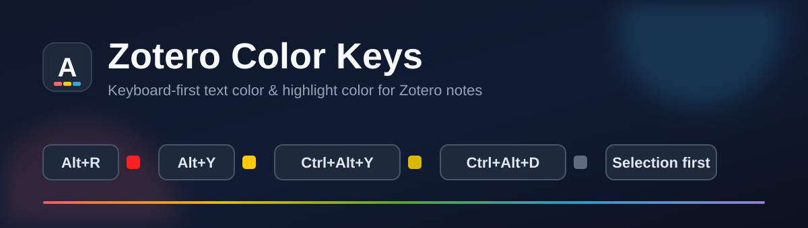

<p align="center">
  
</p>

<p align="center">
  <a href="https://github.com/meaning-infinite/zotero-color-keys/releases/latest"></a>
  <a href="https://github.com/meaning-infinite/zotero-color-keys/actions/workflows/ci.yml"></a>
  
  <a href="LICENSE"></a>
  
</p>

<p align="center">
  <b>在 Zotero 笔记里按一下快捷键就上色，不再点三次菜单。</b><br>
  <sub>Keyboard-first text color and highlight color for Zotero notes. 8 official colors, custom keybindings, selection-aware.</sub>
</p>

---

## 为什么

写笔记时想标一段重点，Zotero 原生要给三次点击：选中 → 工具栏 → 找颜色。Better Notes 也没有颜色/高亮快捷键——作者在[讨论 #1195](https://github.com/windingwind/zotero-better-notes/discussions/1195)里说“planned, no time”，相关 issue（[#559](https://github.com/windingwind/zotero-better-notes/issues/559)、[#1229](https://github.com/windingwind/zotero-better-notes/issues/1229)、[#1236](https://github.com/windingwind/zotero-better-notes/issues/1236)）全部关闭未实现。

这个插件只做一件事：**选中文字，按 `Alt+R` 变红；按 `Ctrl+Alt+Y` 变黄高亮。没有选中时作用于当前段落。**

## 功能

- 🎨 **8 种 Zotero 官方颜色** —— 文字色与高亮色各 8 种，颜色值与 Zotero 内置调色板完全一致
- ⌨️ **两套默认键位** —— `Alt+字母` 改文字色，`Ctrl+Alt+字母` 改高亮色，参考幕布键位布局
- 🎯 **选区优先，段落兜底** —— 有选区作用选区，没有选区作用当前段落
- 🔁 **同色再按一次取消** —— 天然 toggle，不需要额外“清除”键
- 🛠 **全部可自定义** —— 设置面板里逐个录制键位，带冲突检测、单行/整体恢复默认
- 🌍 **中繁英三语** —— 简中 / 繁中 / English
- 🧩 **Better Notes 可选增强** —— 装了 BN 时，颜色命令也会出现在它的 Magic Key 命令面板里
- 🪶 **独立实现，MIT** —— 不复制 AGPL 代码，原生编辑器与 BN 编辑器共用同一套实现

## 快捷键

### 文字颜色 · `Alt`（macOS `Option`）

| | 颜色 | 按键 | 颜色值 |
|:--:|---|---|---|
| 🔴 | 红 | `Alt+R` | `#ff2020` |
| 🟠 | 橙 | `Alt+O` | `#ff7700` |
| 🟡 | 黄 | `Alt+Y` | `#ffcb00` |
| 🟢 | 绿 | `Alt+G` | `#4eb31c` |
| 🔵 | 蓝 | `Alt+B` | `#05a2ef` |
| 🟣 | 紫 | `Alt+P` | `#7953e3` |
| 🩷 | 品红 | `Alt+M` | `#eb52f7` |
| ⚪ | 灰 | `Alt+A` | `#7e8386` |
| ↩️ | 恢复默认 | `Alt+D` | — |

### 高亮 · `Ctrl+Alt`（macOS `Cmd+Option`）

| | 颜色 | 按键 | 颜色值 |
|:--:|---|---|---|
| 🟡 | 黄 | `Ctrl+Alt+Y` | `#ffd40080` |
| 🔴 | 红 | `Ctrl+Alt+R` | `#ff666680` |
| ⚪ | 灰 | `Ctrl+Alt+H` | `#aaaaaa80` |
| 🟢 | 绿 | `Ctrl+Alt+G` | `#5fb23680` |
| 🔵 | 蓝 | `Ctrl+Alt+B` | `#2ea8e580` |
| 🩷 | 粉 | `Ctrl+Alt+P` | `#e56eee80` |
| 🟠 | 橙 | `Ctrl+Alt+O` | `#f1983780` |
| 🟣 | 紫 | `Ctrl+Alt+U` | `#a28ae580` |
| 🧽 | 清除高亮 | `Ctrl+Alt+D` | — |
| 🧹 | 清除整段颜色 | `Ctrl+Alt+Shift+D` | — |

> Windows 上 `Ctrl+Alt` 接近 AltGr，个别键盘布局可能吞键。若快捷键不响应，到设置里改成 `Ctrl+Shift+Alt` 组合即可。

## PDF 阅读器快捷键（beta）

PDF 里没有“文字颜色”，只有批注颜色。用修饰键区分批注类型，和笔记侧保持一致：

| 按键 | 作用 |
|---|---|
| `Alt+字母` | 下划线颜色（红/黄/绿/蓝… 同笔记文字色表） |
| `Ctrl+Alt+字母` | 高亮颜色（macOS `Cmd+Option`） |

- 焦点在侧栏注释输入框里时快捷键**同样生效**，不需要先切换焦点
- 选中已有批注后按快捷键：类型不一致会先转换类型再改色（选中的是高亮按 `Alt+字母` → 变成下划线，反之亦然）
- 选中文本后弹出的工具条已精简：
  - 第一行 8 个颜色保留，最左侧叠加一个模式指示器（默认“Aa + 下划线”，按住 `Ctrl`/`Cmd` 变成高亮色块）
  - 第二行原来“高亮 / 下划线”两个 A 按钮被移除，只留一行灰色极简说明，行距压缩
  - 默认点颜色 = 下划线；按住 `Ctrl`/`Cmd` 点颜色 = 高亮
- 选中的已有批注按颜色快捷键 = 直接改色，不叠新批注

## 安装

**方式一：Zotero 插件市场（推荐）**

Zotero → 工具 → 插件 → 插件市场，搜索 **Zotero Color Keys**，一键安装。

**方式二：手动安装**

1. 从 [Releases](https://github.com/meaning-infinite/zotero-color-keys/releases/latest) 下载最新的 `zotero-color-keys.xpi`
2. Zotero → 工具 → 插件 → 齿轮 → **Install Add-on From File…**
3. 选择下载的 `.xpi`，重启 Zotero

## 自定义键位

设置 → **Color Keys**：

- 颜色快捷键为表格布局：一行一种颜色，两列分别配置“文字颜色”和“高亮”，表头与输入框居中对齐
- 点击任意输入框进入录制，按下想要的组合即可；`Esc` 取消，`Backspace` 解绑
- 同一个组合绑定到两个动作会标红提示；与 Zotero 原生快捷键重叠会标黄警告
- 只需一个“全部恢复默认”按钮，不再逐行重置
- PDF 分组附使用说明：快捷键在侧栏注释输入框聚焦时也生效
- 底部诊断区显示挂载的编辑器数量、当前打开的 PDF reader 数量与 Better Notes 检测结果，排障用

## 兼容性

| 项 | 范围 |
|---|---|
| Zotero | 8.0 – 10.*（开发与测试在 10.0.6） |
| 编辑器 | Zotero 原生笔记（标签页 / 侧栏 / 独立窗口）、Better Notes 富文本编辑器与独立笔记窗口 |
| 系统 | Windows / macOS / Linux |
| 许可 | MIT |

## 已知限制

- **PDF 阅读器**：高亮/下划线快捷键仍在 beta，需要真实 PDF 验证；阅读器颜色按钮图标的 Ctrl 态改造还在计划中
- 纯文本选区才能新建 PDF 批注；无文本层的扫描 PDF 只能改已有批注或手绘标注的颜色
- Better Notes 的 Markdown 模式暂不接管（CodeMirror 源视图里直接写颜色会污染源码），会透传按键
- 只读笔记不拦截快捷键，按键原样透传

## 开发

```bash
pnpm install
pnpm start     # 构建并启动 Zotero（热重载）
pnpm test      # 单元测试（vitest）
pnpm build     # 产出 .scaffold/build/*.xpi
pnpm release   # 发布
```

技术栈：TypeScript + esbuild + [zotero-plugin-scaffold](https://github.com/zotero-plugin-dev/zotero-plugin-scaffold) + [zotero-plugin-toolkit](https://github.com/windingwind/zotero-plugin-toolkit)。

实现要点（都踩过坑，记录在仓库里）：

- 笔记编辑器是独立 iframe，快捷键必须挂在编辑器实例的 iframe 捕获阶段，不能依赖主窗口监听
- ProseMirror 的 mark attrs 必须在 iframe realm 内创建，否则被 Xray 拦掉，报 `No value supplied for attribute color`
- 同一条笔记存在侧栏 + 标签页两个编辑器实例，需要按 `itemID` 去重

## 文档

| 文档 | 内容 |
|---|---|
| [设计规格](docs/superpowers/specs/2026-10-23-zotero-color-keys-design.md) | 范围、架构、键位、决策记录 |
| [实现计划](docs/superpowers/plans/2026-10-23-zotero-color-keys-plan.md) | 分阶段计划与进度 |
| [Hook spike](docs/spike/2026-10-23-editor-hook.md) | 编辑器挂载与 mark 写入验证 |
| [E2E 记录](docs/testing/2026-10-23-e2e-shortcuts.md) | 快捷键端到端验证 |

## 贡献

Issues 与 PR 都欢迎。提 PR 前请先看 [AGENTS.md](AGENTS.md)；改行为请同步更新规格文档与 `CHANGELOG.md`，并保证 `pnpm typecheck && pnpm test` 通过。

## License

[MIT](LICENSE) © 2026 meaning-infinite

<details>
<summary><b>English</b></summary>

**Zotero Color Keys** adds customizable keyboard shortcuts for text color and highlight color in Zotero notes.

- 8 official Zotero colors, selection-first with current-paragraph fallback
- Press the same color again to remove it
- `Alt+letter` for text color, `Ctrl+Alt+letter` for highlight, fully rebindable in Preferences → Color Keys
- Works in the native note editor and Better Notes editors; optional Magic Key integration
- zh-CN / zh-TW / en-US UI, MIT licensed

Install from the Zotero Add-on Market or from [Releases](https://github.com/meaning-infinite/zotero-color-keys/releases/latest). PDF reader support is planned for v1.1.

</details>
